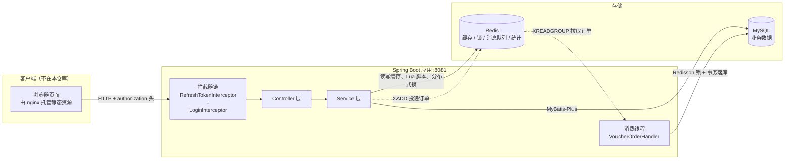
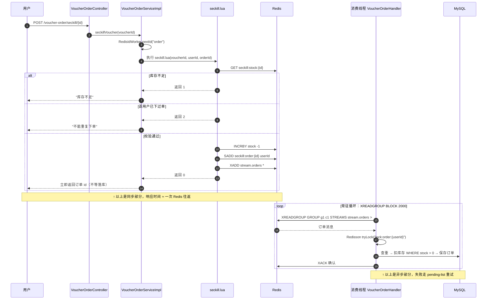

# hm-dianping

基于 Spring Boot + MyBatis-Plus + Redis 的仿大众点评项目，围绕 Redis 在真实业务场景下的应用展开：缓存一致性、分布式锁、全局唯一 ID、Lua 脚本秒杀、消息队列异步下单、点赞排行、好友关注与 Feed 流、GEO 附近商户、BitMap 签到、HyperLogLog UV 统计。

> ⚠️ **声明**：本项目为**学习项目**，仅供学习交流，请勿用于商业用途。

## 目录

- [架构](#架构)
- [技术栈](#技术栈)
- [功能一览](#功能一览)
- [秒杀链路时序](#秒杀链路时序)
- [Redis Key 一览](#redis-key-一览)
- [项目结构](#项目结构)
- [接口一览](#接口一览)
- [快速开始](#快速开始)
- [测试账号](#测试账号)
- [文档索引](#文档索引)
- [Roadmap](#roadmap)

## 架构



Redis 承担的职责一览：

| 模块 | Redis 的角色 |
| --- | --- |
| 登录 | 存验证码与登录态，替代 Session |
| 商户缓存 | 缓存穿透/击穿防护，逻辑过期 + 异步重建 |
| 秒杀 | 原子校验、库存预扣、消息队列 |
| 社交 | 点赞排行、关注关系、Feed 收件箱 |
| 附近商户 | GEO 存经纬度，按距离排序 |
| 签到 | BitMap 存签到记录 |
| UV | HyperLogLog 估算基数 |

## 技术栈

| 组件 | 版本 |
| --- | --- |
| Spring Boot | 2.3.12.RELEASE |
| MyBatis-Plus | 3.4.3 |
| MySQL | 5.x（驱动 mysql-connector-java 5.1.47） |
| Redis | Spring Data Redis + Lettuce 连接池（**需 5.0+**） |
| Redisson | 3.16.8（分布式锁） |
| Hutool | 5.7.17 |
| JDK | 1.8 |

## 功能一览

### 1. 短信登录（Redis 替代 Session）

- 验证码存 Redis：`login:code:{phone}`，TTL 2 分钟；验证码为**模拟发送**，仅以 debug 日志打印到控制台。
- 登录成功生成 UUID token（不带横线），用户信息以 **Hash** 存入 `login:token:{token}`，TTL 120 分钟，只存非空字段。
- 双拦截器（`config/MvcConfig.java`）：
  - `RefreshTokenInterceptor`（order 0，拦截 `/**`）：解析请求头 `authorization` 中的 token，从 Redis 取用户写入 `UserHolder`，并**刷新 token 有效期**（活跃用户不掉线）。
  - `LoginInterceptor`（order 1）：只负责校验 `UserHolder` 是否为空，拦截未登录请求；放行 `/user/code`、`/user/login`、`/blog/hot`、`/shop/**`、`/shop-type/**`、`/upload/**`、`/voucher/**`。

> 详细笔记：[01 · 登录与会话](docs/notes/01-登录与会话.md)

### 2. 商户缓存

- **缓存穿透**：查库为空时写入空字符串（`""`）并加短 TTL（`CACHE_NULL_TTL = 2` 分钟）。
- **缓存击穿**：`utils/CacheClient.java` 泛型封装了两种方案，`ShopServiceImpl` 中保留了两种实现：
  - `queryWithMutext` —— 互斥锁 + 双检，未命中者自旋重试；
  - `queryWithLogicalExpire` —— **逻辑过期**，value 包一层 `RedisData`（数据 + 过期时间戳），命中但逻辑过期后返回旧数据，同时提交 `CACHE_REBUILD_EXECUTOR` 线程池**异步重建**缓存。**当前 `queryById` 走的就是这条路径**。
- **缓存一致性**：`ShopServiceImpl.update` 采用 `@Transactional` **先更新数据库、再删除缓存**。
- **商户类型缓存**：`cache:shopType:list`，Redis **List** 存 JSON，TTL 30 分钟。
- 兜底：`ShopServiceImpl.tryLock/unlock` 提供基于 `SETNX` 的简易锁（`SimpleRedisLock` 用 Lua 脚本 `unlock.lua` 保证「判断 + 删除」原子性，避免误删他人锁）。

> 详细笔记：[02 · 缓存三兄弟与双写一致](docs/notes/02-缓存三兄弟与双写一致.md) ｜ 排错记录：[07 · 踩坑：unlock(null)](docs/notes/07-踩坑：缓存击穿-unlock-null.md)

### 3. 优惠券秒杀（Lua + 消息队列异步下单）

- 全局唯一 ID：`utils/RedisIdWorker.java` —— 时间戳左移 32 位 + Redis 每日自增序列（`icr:{前缀}:{yyyy:MM:dd}`），配合线程池压测验证。
- `VoucherOrderServiceImpl.seckillVoucher`：
  1. 生成订单 ID；
  2. 执行 `resources/seckill.lua` **原子**完成「库存判断 → 一人一单判断 → 扣库存 → 记录用户 → 发送消息」；
  3. Lua 返回 `1` 库存不足、`2` 重复下单、`0` 抢购成功，成功即返回订单 ID，**不阻塞等下单结果**。
- `seckill.lua` 通过 `XADD stream.orders *` 把订单写入 **Redis Stream** 作为消息队列。
- `VoucherOrderHandler`（单线程线程池，`@PostConstruct` 启动）循环 `XREADGROUP GROUP g1 c1 BLOCK 2000` 消费消息；异常时转入 `handlePendingList` 扫描 pending-list 重试，成功后 `XACK` 确认。
- 落库 `createVoucherOrder`：Redisson 分布式锁 `lock:order:{userId}` 保证一人一单，`@Transactional` 内先查重、再乐观扣库存（`stock = stock - 1 ... AND stock > 0`）、最后保存订单。
- 新增秒杀券时同步把库存写入 `seckill:stock:{voucherId}`。
- 代码中保留了早期 **阻塞队列 `ArrayBlockingQueue`** 方案的注释，便于对照演进过程。

> 详细笔记：[04 · 秒杀异步下单](docs/notes/04-秒杀异步下单.md)

### 4. 达人探店与点赞（Redis ZSet 排行）

- `BlogServiceImpl.likeBlog`：点赞/取消点赞双态切换，同步更新数据库 `liked` 字段，并以 `System.currentTimeMillis()` 作为 score 写入 ZSet `blog:liked:{blogId}`（**ZSet 天然去重**）。
- `queryBlogLikes`：`ZRANGE key 0 4` 取**点赞 Top5 用户**，再用 `ORDER BY FIELD(id, ...)` 保证返回顺序与 Redis 一致。
- `isBlogLiked`：用 `ZSCORE` 判断当前登录用户是否点过赞，未登录直接跳过。
- `queryBlogById`、`queryHotBlog`（按 `liked` 倒序分页）均会补齐作者信息与点赞状态。

### 5. 好友关注与 Feed 流

- `FollowServiceImpl.follow`：关注写库 `tb_follow` 并 `SADD follows:{userId}`；取关删库并 `SREM`。
- `followCommons`：`SINTER follows:{me} follows:{other}` 求**共同关注**。
- `saveBlog`：发布探店笔记后，查所有粉丝，`ZADD feed:{粉丝id} blogId 时间戳` —— **推模式**写收件箱。
- `queryBlogOfFollow`：`ZREVRANGEBYSCORE` 滚动分页（每页 2 条），解析 `minTime` 与 `offset` 解决**同时间戳消息重复**问题，返回 `ScrollResult`。

> 详细笔记：[05 · 社交：点赞与 Feed 流](docs/notes/05-社交：点赞与 Feed 流.md)

### 6. 附近商户（Redis GEO）

- 商铺经纬度按类型分组，以 `shop:geo:{typeId}` 为 key 批量 `GEOADD`（初始化见 `HmDianPingApplicationTests.loadShopData`）。
- `queryShopByType`：有坐标时用 `GEORADIUS`（圆心 + 半径 5km）查询并按距离排序，通过 `limit(end)` + `skip(from)` 实现分页，返回结果附带距离（`Shop.distance`）；无坐标时退化为普通数据库分页。

### 7. 用户签到（Redis BitMap）

- `UserServiceImpl.sign`：key 为 `sign:{userId}:{yyyyMM}`，`SETBIT key (dayOfMonth - 1) 1`，每月一个 BitMap，1 天 1 bit。
- `signCount`：`BITFIELD GET u{dayOfMonth} 0` 取出截至今天的所有签到位，再**逐位与 1 做与运算并从低位往高位统计连续 1 的个数**，得到本月**连续签到天数**。

### 8. UV 统计（HyperLogLog）

- 见 `HmDianPingApplicationTests.testHyperLogLog`：每日随机用户 `PFADD hll1`，最后 `PFCOUNT` 统计 UV，用于在**极低内存**下估算海量去重访问量。

> 详细笔记：[06 · 地理与统计](docs/notes/06-地理与统计.md)（GEO / BitMap / HyperLogLog 三合一）

### 9. 分布式锁

- `utils/ILock` + `SimpleRedisLock`：`SETNX + 过期时间` 实现，**Lua 脚本释放锁**（`unlock.lua`）保证「校验持有者 + 删除」原子。
- 生产方案使用 **Redisson**：`RLock lock = redissonClient.getLock(...)`，支持可重入、看门狗续期、重试；`RedissonConfig` 中配置了单机 + 两个额外节点（6380/6381）用于联锁/红锁练习。

> 详细笔记：[03 · 分布式锁](docs/notes/03-分布式锁.md)

## 秒杀链路时序

全项目最复杂的一条链路，图里把「同步返回」和「异步落库」两段标出来了：



## Redis Key 一览

这张表基本就是本项目的知识点地图。常量定义在 [`utils/RedisConstants.java`](src/main/java/com/hmdp/utils/RedisConstants.java)。

| Key | 结构 | TTL | 用途 | 来源 |
| --- | --- | --- | --- | --- |
| `login:code:{phone}` | String | 2 分钟 | 登录验证码 | `LOGIN_CODE_KEY` |
| `login:token:{token}` | Hash | 120 分钟（每次请求续期） | 登录用户信息 | `LOGIN_USER_KEY` |
| `cache:shop:{id}` | String | 30 分钟 / 逻辑过期 | 商户缓存（`RedisData` 包裹） | `CACHE_SHOP_KEY` |
| `cache:shopType:list` | List | 30 分钟 | 商铺类型缓存 | `CACHE_SHOP_TYPE_KEY` |
| `lock:shop:{id}` | String | 10 秒 | 缓存重建互斥锁 | `LOCK_SHOP_KEY` |
| `lock:order:{userId}` | Hash（Redisson） | 看门狗自动续期 | 秒杀一人一单锁 | `VoucherOrderServiceImpl` |
| `seckill:stock:{voucherId}` | String | 无 | 秒杀库存 | `SECKILL_STOCK_KEY` |
| `seckill:order:{voucherId}` | Set | 无 | 已下单用户（一人一单） | `seckill.lua` |
| `stream.orders` | Stream | 无 | 下单消息队列 | `seckill.lua` |
| `icr:{prefix}:{yyyy:MM:dd}` | String | 无 | 全局唯一 ID 自增序列 | `RedisIdWorker` |
| `blog:liked:{blogId}` | ZSet | 无 | 点赞用户，score = 点赞时间戳 | `BLOG_LIKED_KEY` |
| `feed:{userId}` | ZSet | 无 | 粉丝收件箱，score = 发布时间戳 | `FEED_KEY` |
| `follows:{userId}` | Set | 无 | 关注列表（用于求共同关注） | `FollowServiceImpl` |
| `shop:geo:{typeId}` | GEO（底层 ZSet） | 无 | 商铺经纬度 | `SHOP_GEO_KEY` |
| `sign:{userId}:{yyyyMM}` | String（BitMap） | 无 | 签到记录，1 天 1 bit | `USER_SIGN_KEY` |
| `hll1` | HyperLogLog | 无 | UV 统计（测试用） | `testHyperLogLog` |

> 「TTL 无」表示代码里没有显式设置过期时间。生产环境应当补上，否则这些 key 会永久驻留。

## 项目结构

```
src/main/java/com/hmdp/
├── config/          # MvcConfig（拦截器注册）、MybatisConfig、RedissonConfig、WebExceptionAdvice
├── controller/      # 接口层：用户/商铺/商铺类型/优惠券/秒杀订单/探店笔记/关注/上传
├── dto/             # Result、UserDTO、LoginFormDTO、ScrollResult
├── entity/          # MyBatis-Plus 实体
├── mapper/          # Mapper 接口
├── service/impl/    # 业务实现
└── utils/           # CacheClient、RedisIdWorker、SimpleRedisLock、拦截器、RedisConstants、UserHolder 等
src/main/resources/
├── application.yaml
├── seckill.lua            # 秒杀原子脚本（含 XADD 发消息）
├── unlock.lua             # 分布式锁释放脚本
├── db/hmdp.sql            # 建表 + 初始数据（11 张表）
└── mapper/VoucherMapper.xml
src/test/java/com/hmdp/
├── HmDianPingApplicationTests.java   # 商户缓存预热、ID Worker 压测、GEO 数据初始化、HyperLogLog 测试
├── RedissonTest.java                 # Redisson 锁 / MultiLock 演示
└── TokenGenerator.java               # 批量造登录 token，配合 JMeter 压测
docs/                      # 学习笔记与接口验证素材（见「文档索引」）
tools/                     # 压测辅助 Python 脚本（见 tools/README.md）
```

## 接口一览

| 模块 | 方法 | 路径 | 需登录 |
| --- | --- | --- | --- |
| 用户 | POST | `/user/code`、`/user/login` | ✗ |
| 用户 | POST | `/user/logout`（空实现） | ✓ |
| 用户 | GET | `/user/me`、`/user/info/{id}`、`/user/{id}` | ✓ |
| 签到 | POST / GET | `/user/sign`、`/user/sign/count` | ✓ |
| 商铺 | GET | `/shop/{id}`、`/shop/of/type`、`/shop/of/name` | ✗ |
| 商铺 | POST / PUT | `/shop` | ✗ |
| 商铺类型 | GET | `/shop-type/list` | ✗ |
| 优惠券 | POST | `/voucher`、`/voucher/seckill` | ✗ |
| 优惠券 | GET | `/voucher/list/{shopId}` | ✗ |
| 秒杀下单 | POST | `/voucher-order/seckill/{id}` | ✓ |
| 探店笔记 | POST | `/blog` | ✓ |
| 探店笔记 | PUT | `/blog/like/{id}` | ✓ |
| 探店笔记 | GET | `/blog/{id}`、`/blog/hot` | ✗ |
| 探店笔记 | GET | `/blog/of/me`、`/blog/of/user`、`/blog/likes/{id}`、`/blog/of/follow` | ✓ |
| 关注 | PUT | `/follow/{id}/{isFollow}` | ✓ |
| 关注 | GET | `/follow/or/not/{id}`、`/follow/common/{id}` | ✓ |
| 上传 | POST / GET | `/upload/blog`、`/upload/blog/delete` | ✗ |

> 所有接口统一返回 `Result`（`success` / `errorMsg` / `data` / `total`）。
> 全部接口的现成请求集合见 [`docs/api/http/hmdp.http`](docs/api/http/hmdp.http)。

### 关于前端

**本仓库只包含后端代码，没有前端页面。**

项目本身不含 `static` 目录，前端是**由 nginx 单独托管的静态页面**（课程资料包，目录形如 `nginx-1.30.4`）——`utils/SystemConstants.java` 里的 `IMAGE_UPLOAD_DIR` 指向的正是 nginx 的图片目录。

因此，**直接启动本应用访问 `/` 是拿不到页面的**。想验证功能，请用 [`docs/api/README.md`](docs/api/README.md) 里的方式直接发 HTTP 请求。

想要完整页面的话，需要自行准备前端静态资源并用 nginx 托管，且 nginx 里的 API 代理地址要指向本项目的 **8081** 端口。

## 快速开始

### 1. 环境准备

- JDK 1.8、Maven
- MySQL：导入 `src/main/resources/db/hmdp.sql`（库名 `hmdp`，含 11 张表 + 初始数据）
- Redis：**5.0 及以上**（秒杀异步下单依赖 Stream 的 `XADD` / `XREADGROUP`）
- 秒杀功能需额外执行一次 `XGROUP CREATE stream.orders g1 0` 创建消费组

### 2. 配置

编辑 `src/main/resources/application.yaml`：

```yaml
spring:
  datasource:
    url: jdbc:mysql://127.0.0.1:3306/hmdp?useSSL=false&serverTimezone=UTC
    username: root
    password: 123456
  redis:
    host: 192.168.15.128
    port: 6379
    password: 123456
```

另外 `config/RedissonConfig.java` 中的 Redis 地址（`192.168.15.128:6379/6380/6381`）需与 `application.yaml` 保持一致。只跑单机时保留 `redissonClient` 即可，`redissonClient2/3` 是 MultiLock 演示用的（`RedissonTest` 会用到）。

### 3. 启动

```bash
mvn spring-boot:run
```

服务端口 **8081**。

### 4. 预热（可选但推荐）

- **商铺缓存**：商铺走逻辑过期方案，**必须预热**才有数据。跑一次 `HmDianPingApplicationTests.testSaveShop`。
- **GEO 数据**：跑一次 `HmDianPingApplicationTests.loadShopData`。
- **秒杀库存**：调 `POST /voucher/seckill` 新增秒杀券时会自动写入 `seckill:stock:{id}`。

跑不起来时先看 [`docs/常见问题.md`](docs/常见问题.md)。

## 测试账号

登录使用手机号 + 验证码，验证码为**模拟发送，不接真实短信**。

1. `POST /user/code?phone=13688888888` → 控制台打印验证码（需 `logging.level.com.hmdp: debug`）：
   ```
   发送验证码成功，验证码：123456
   ```
2. `POST /user/login`，body：`{"phone":"13688888888","code":"123456"}` → 返回 token。
3. 后续请求在请求头携带 `authorization: <token>`（**全小写，无 `Bearer ` 前缀**）。

> 说明：`13688888888` 是约定俗成的测试号；`db/hmdp.sql` 中预置的用户是 `13686869696`（小鱼同学）等，用它登录可直接复用库中已有的探店数据。

压测需要批量 token 时，见 [`tools/README.md`](tools/README.md)。

## 文档索引

| 文档 | 内容 |
| --- | --- |
| [`docs/README.md`](docs/README.md) | 文档总索引 |
| [`docs/notes/`](docs/notes/) | 7 篇 Redis 场景学习笔记（登录、缓存、锁、秒杀、社交、地理统计、踩坑） |
| [`docs/常见问题.md`](docs/常见问题.md) | 15 条排查项：启动失败、401、秒杀不生效、缓存预热…… |
| [`docs/api/README.md`](docs/api/README.md) | 不装前端，怎么直接用 HTTP 把接口跑一遍 |
| [`docs/api/http/hmdp.http`](docs/api/http/hmdp.http) | 现成请求集合，IDEA 里点开就能发 |
| [`docs/开发日志.md`](docs/开发日志.md) | 功能里程碑表 + 原始开发记录 |
| [`tools/README.md`](tools/README.md) | 压测辅助脚本说明 |

**推荐阅读顺序**：本 README → [`docs/notes/01`](docs/notes/01-登录与会话.md) → [`02`](docs/notes/02-缓存三兄弟与双写一致.md) → [`07`](docs/notes/07-踩坑：缓存击穿-unlock-null.md) → [`03`](docs/notes/03-分布式锁.md) → [`04`](docs/notes/04-秒杀异步下单.md) → [`05`](docs/notes/05-社交：点赞与 Feed 流.md) → [`06`](docs/notes/06-地理与统计.md)。

## Roadmap

已知但**未做**的部分，按价值排序：

- [ ] `/user/logout` 真实实现（目前返回"功能未完成"，逻辑上只需 `DELETE login:token:{token}`）
- [ ] `tb_sign` 表与 BitMap 方案的关系说明——建表脚本里有这张表，但签到数据实际完全存在 Redis，属于学习项目的取舍
- [ ] 单元测试补断言——`src/test` 下 6 个 `@Test` 全是手动演示型（预热、压测、造数据），没有针对 Service/Controller 的断言式测试
- [ ] Dockerfile / docker-compose，一键起 MySQL + Redis 环境
- [ ] CI（最小化的 `mvn -B test` workflow）
- [ ] 秒杀大 V 场景优化：推拉结合、`size` 限流、缓存 key 的 TTL 补全
